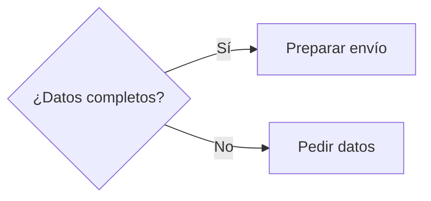
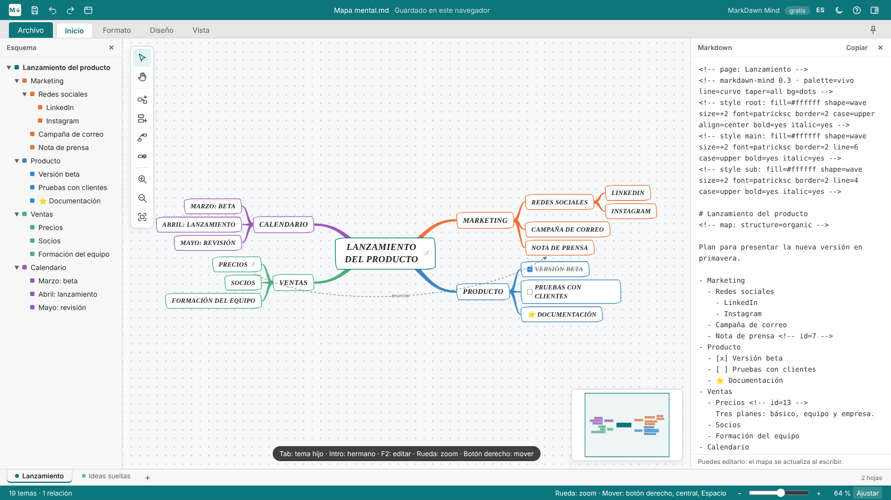

# MarkDawn Apps

**Herramientas con el aspecto de Office de siempre que lo guardan todo en Markdown.**

Markdown es el formato que mejor entienden las IA, y funciona en todas partes: GitHub, Obsidian, wikis, sitios de documentación. Pero pedirle a alguien sin conocimientos técnicos que escriba en él es una barrera real. MarkDawn Apps mantienen la interfaz que la gente ya conoce y solo guardan Markdown.

[Read in English](README.md)

| Aplicación | Qué es | Pruébala |
| --- | --- | --- |
| **MarkDawn Writer** | Un editor de documentos con aspecto de Word | [Demo en línea →](https://diegocano-dev.github.io/markdawn-apps/writer/) |
| **MarkDawn Slides** | Un editor de diapositivas con aspecto de PowerPoint | [Demo en línea →](https://diegocano-dev.github.io/markdawn-apps/slides/) |
| **MarkDawn Mind** | Mapas mentales con cinta tipo Office (en español e inglés) | [Demo en línea →](https://diegocano-dev.github.io/markdawn-apps/mind/) |

Cada una es un único archivo HTML, sin dependencias ni compilación. La [página de inicio](https://diegocano-dev.github.io/markdawn-apps/) enlaza a las tres.

---

## MarkDawn Writer

**Escribe como en Word. Guarda en Markdown.**


Nunca ves un `#` ni un `**` mientras escribes, y cada documento se guarda como Markdown limpio que pueden leer personas, herramientas e IA.

- **Cinta tipo Word** con las pestañas Archivo, Inicio, Insertar y Vista, y una pestaña Tabla al estar dentro de una tabla
- **Galería de estilos**: Normal, Título 1–4, Cita y Código
- **Formato**: negrita, cursiva, tachado, código en línea, vínculos y borrar formato
- **Listas** con viñetas, numeradas y de tareas, con Tab y Mayús+Tab para cambiar de nivel
- **Tablas**, imágenes, bloques de código, citas y líneas horizontales
- **Panel Markdown en directo**, en el lateral o abajo, que también puedes editar
- **Atajos de Markdown al escribir**: `# `, `- `, `1. `, `> `, `[ ] `, `**negrita**`, `` `código` ``
- **Abre cualquier archivo `.md`** sin romperlo, y pega limpio desde Word, Google Docs y páginas web
- Panel de navegación, buscar y reemplazar, zoom, deshacer y rehacer, contador de palabras

Markdown no tiene alineación, así que Writer la guarda como un comentario invisible encima del bloque:

```markdown
<!-- align: center -->
# Bienvenido
```

---

## MarkDawn Slides

**Diseña diapositivas como en PowerPoint. Guárdalas en un Markdown que una IA puede leer y reconstruir.**


- **Diseño libre**: mueve y redimensiona cualquier elemento, con guías inteligentes, cuadrícula opcional y más de 20 diseños de diapositiva
- **Más de 90 formas** con sus nombres de PowerPoint, y colores de relleno, contorno y texto
- **Texto con estilo por línea**: título, subtítulo, encabezado, texto, viñetas, numeración y tareas, negrita, cursiva, código y alineación vertical
- **Conectores** que se anclan a las formas: rectos o angulares con esquinas redondeadas, flecha en cualquier extremo, texto en la flecha y un trazado que esquiva otros objetos
- **Diagramas de flujo guardados en Mermaid**, que GitHub, Obsidian y muchos visores dibujan automáticamente
- **Gráficos** (columnas, barras, líneas, circular y anillo) y **tablas** (8 estilos y formato por filas y columnas) guardados con sus datos reales
- **Orden de lectura** calculado automáticamente, con grupos y zonas de lectura para los bloques que van juntos
- **Secciones**, modo presentación, paneles ajustables y zoom
- **Exportar Markdown simple**: sin comentarios ni posiciones, legible en cualquier visor

### Cómo se guarda una diapositiva

Cada elemento lleva un comentario con su posición y tamaño en % de la diapositiva, seguido de Markdown normal, en orden de lectura:

```markdown
---

<!-- slide 2 · layout: imageLeft -->

<!-- image: x=0 y=0 w=45 h=100 -->


<!-- text: x=50 y=10 w=45 h=20 valign=bottom -->
# Resultados del trimestre

<!-- text: x=50 y=34 w=45 h=56 -->
- Ventas +12 %
- Tres clientes nuevos
```

Las formas unidas por conectores se escriben como un único diagrama Mermaid. Las líneas `%%` son comentarios de Mermaid que guardan la posición exacta de cada forma: los visores las ignoran y MarkDawn Slides recupera la colocación:

````markdown

````

---

## MarkDawn Mind

**Mapas mentales como en Office. Guardados en un Markdown que cualquier IA puede leer.**



Este repositorio tiene **MarkDawn Mind Lite**, la edición gratuita. La interfaz está en español y en inglés y sigue el idioma del navegador. Puedes cambiarla con el botón ES / EN.

- **Pensada para el teclado**: Tab crea un tema hijo, Intro uno hermano, y basta con escribir para editar
- **Mapas orgánicos** con ramas curvas y cónicas, además de mapa a la derecha y árbol (tipo carpetas)
- **Los temas se quedan donde los sueltas**, con sus ramas; si lo sueltas sobre otro tema, pasa a esa rama
- **Navegación a tu gusto**: zoom hacia el puntero, mover con el botón derecho, el central o Espacio, todo configurable (Vista → Ratón y zoom)
- **Varias hojas en un archivo**, notas, tareas, marcadores, vínculos, relaciones y temas flotantes
- **Panel Markdown en directo** que también puedes editar, esquema, minimapa, modo oscuro y cinta arriba, a la izquierda o a la derecha
- **Abre cualquier Markdown**: los títulos y las listas se convierten en ramas
- Ayuda incluida: pulsa **F1**

La edición completa añade más estilos de mapa (relieve 3D, placas con marco de metal…), organigrama, línea de tiempo y radial, más de 30 formas, 10 tipos de rama, ramas 3D y formato por niveles. Abre los mismos archivos.

### Cómo se guarda un mapa mental

El mapa es una lista anidada normal. El formato y las posiciones van en comentarios HTML que los visores no muestran:

```markdown
<!-- markdawn-mind 0.3 · palette=vivo line=curve taper=all -->
<!-- style main: shape=pill border=2 line=6 case=upper -->

# Lanzamiento del producto
<!-- map: structure=organic -->

- Marketing <!-- color=#e8743b -->
  - Redes sociales
  - Nota de prensa
- Producto
  - [x] Versión beta
  - [ ] Pruebas con clientes
```

Los archivos con varias hojas empiezan cada una con `<!-- page: Nombre -->` y las separan con `---`.

---

## Cómo usarlas

- **En línea**: abre las demos enlazadas arriba.
- **Sin conexión**: descarga `writer/index.html` (Writer), `slides/index.html` (Slides) o `mind/index.html` (Mind) y ábrelo en cualquier navegador moderno.
- **En tu propia página**: Writer y Mind ofrecen una pequeña API.

```js
MarkDawn.getMarkdown();          // devuelve el documento en Markdown
MarkDawn.setMarkdown('# Hola');  // carga Markdown en el editor

MarkDawnMind.getMarkdown();          // el archivo completo del mapa
MarkDawnMind.setMarkdown('# Idea\n- Uno\n- Dos');
```

## Próximamente

- Abrir archivos `.md` en Slides
- Temas: tipos de letra y colores para todo el documento o la presentación, sin cambiar el Markdown
- Interfaz en inglés para Writer y Slides
- App instalable (PWA) y versión de escritorio para Windows
- Una librería y plugins para ver los archivos MarkDawn en Obsidian, VS Code y páginas web

## Licencia

[MIT](LICENSE) © 2026 Diego Cano
