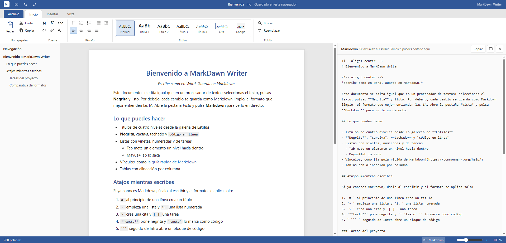

# MarkDawn Writer

**Escribe como en Word. Guarda en Markdown.**

La primera aplicación de **MarkDawn Apps**: herramientas con el aspecto de Office de siempre que lo guardan todo en Markdown.

Un editor de documentos ligero, con aspecto de Word, que lee y guarda Markdown puro. Nunca ves un `#` ni un `**` mientras escribes, y cada documento se guarda como Markdown limpio que pueden leer personas, herramientas e IA.

**[Pruébalo en línea →](https://diegocano-dev.github.io/markdawn-apps/)**

[Read in English](README.md)



## Por qué

Markdown es el formato que mejor entienden las IA, y funciona en todas partes: GitHub, Obsidian, wikis, sitios de documentación. Pero pedirle a alguien sin conocimientos técnicos que escriba en él es una barrera real, y la mayoría de editores de Markdown no se parecen a las herramientas que la gente ya conoce. MarkDawn Writer mantiene la cinta de Office de siempre y solo guarda Markdown.

## Funciones

- **Cinta tipo Word** con las pestañas Archivo, Inicio, Insertar y Vista, y una pestaña Tabla que aparece al estar dentro de una tabla
- **Galería de estilos**: Normal, Título 1–4, Cita y Código
- **Formato**: negrita, cursiva, tachado, código en línea, vínculos y borrar formato
- **Listas** con viñetas, numeradas y de tareas, con Tab y Mayús+Tab para cambiar de nivel
- **Tablas** con selector de cuadrícula, herramientas de filas y columnas y alineación por columna
- **Imágenes** por dirección web o desde tu equipo, bloques de código con lenguaje, citas y líneas horizontales
- **Panel Markdown en directo**, en el lateral o abajo, que también puedes editar
- **Atajos de Markdown al escribir**: `# `, `- `, `1. `, `> `, `[ ] `, `**negrita**`, `` `código` ``, ` ``` `
- **Abre cualquier archivo `.md`** sin romperlo. Lo que el editor no sabe editar, como HTML o comentarios, se muestra como un bloque y se guarda sin cambios
- **Pegado inteligente** desde Word, Google Docs y páginas web
- Panel de navegación, buscar y reemplazar, zoom, deshacer y rehacer, contador de palabras
- **Un solo archivo HTML, sin dependencias ni compilación**

## Alineación sin romper el Markdown

Markdown no tiene alineación. MarkDawn Writer la guarda como un comentario HTML en la línea de encima del bloque:

```markdown
<!-- align: center -->
# Bienvenido
```

Los visores de Markdown ocultan el comentario, así que el archivo se sigue viendo normal en todas partes, y una IA lo lee como una instrucción clara y no como ruido.

## Cómo usarlo

- **En línea**: abre la [demo](https://diegocano-dev.github.io/markdawn-apps/).
- **Sin conexión**: descarga `index.html` y ábrelo en cualquier navegador moderno.
- **En tu propia página**: el editor ofrece una pequeña API.

```js
MarkDawn.getMarkdown();          // devuelve el documento en Markdown
MarkDawn.setMarkdown('# Hola');  // carga Markdown en el editor
```

## Atajos de teclado

| Acción | Atajo |
| --- | --- |
| Negrita / Cursiva | Ctrl+B / Ctrl+I |
| Tachado | Ctrl+Mayús+X |
| Vínculo | Ctrl+K |
| Título 1–4 / Normal | Ctrl+Alt+1–4 / Ctrl+Alt+0 |
| Viñetas / Numeración / Tareas | Ctrl+Mayús+8 / 7 / 9 |
| Alinear izquierda / centro / derecha / justificar | Ctrl+L / E / R / J |
| Buscar / Reemplazar | Ctrl+F / Ctrl+H |
| Abrir / Guardar | Ctrl+O / Ctrl+S |

## Próximamente

- Estilos personalizables: tipos de letra y colores, sin cambiar el Markdown
- Interfaz en inglés
- App instalable (PWA) y versión de escritorio para Windows
- Un editor de diapositivas con la misma idea, al estilo de PowerPoint
- Paquete npm y componente web para integrarlo

## Licencia

[MIT](LICENSE) © 2026 Diego Cano
