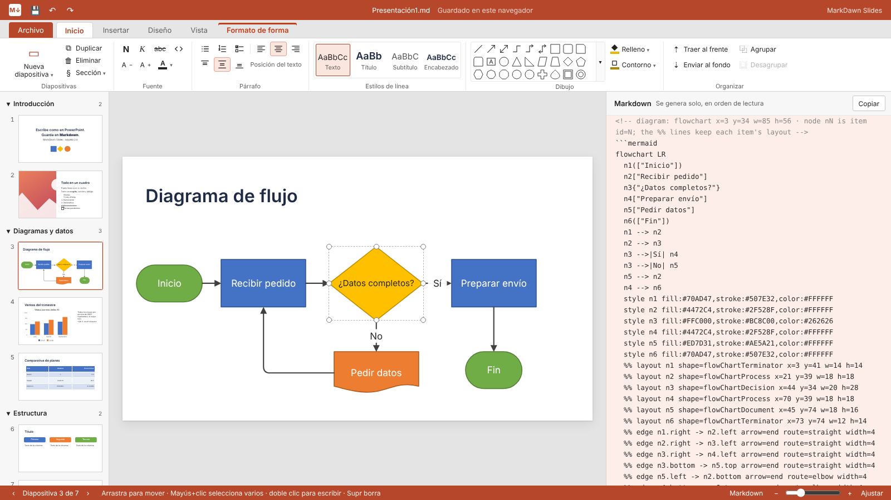
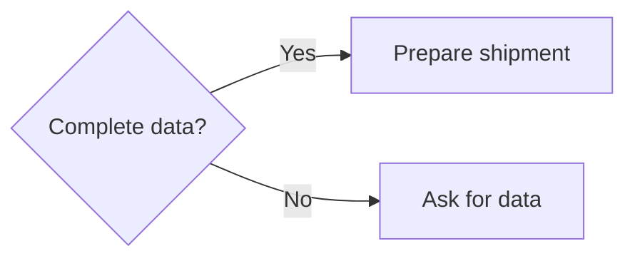

# MarkDawn Apps

**Familiar Office-style tools that save everything as Markdown.**

Markdown is the format AI models understand best, and it works everywhere: GitHub, Obsidian, wikis, documentation sites. But asking someone without technical knowledge to write in it is a real barrier. MarkDawn Apps keep the interface people already know and save only Markdown.

[Leer en español](README.es.md)

| App | What it is | Try it |
| --- | --- | --- |
| **MarkDawn Writer** | A Word-style document editor | [Live demo →](https://diegocano-dev.github.io/markdawn-apps/writer/) |
| **MarkDawn Slides** | A PowerPoint-style slide editor | [Live demo →](https://diegocano-dev.github.io/markdawn-apps/slides/) |

Both are single HTML files with no dependencies and no build step. The [home page](https://diegocano-dev.github.io/markdawn-apps/) links to both.

---

## MarkDawn Writer

**Write like in Word. Save as Markdown.**


You never see a `#` or `**` while you write, and every document is saved as clean Markdown that people, tools and AI models can read.

- **Word-style ribbon** with File, Home, Insert and View tabs, plus a Table tab when you are inside a table
- **Styles gallery**: Normal, Heading 1–4, Quote and Code
- **Formatting**: bold, italic, strikethrough, inline code, links, clear formatting
- **Lists**: bulleted, numbered and task lists, with Tab and Shift+Tab to change levels
- **Tables**, images, code blocks, quotes and horizontal rules
- **Live Markdown panel**, at the side or at the bottom, that you can also edit directly
- **Markdown shortcuts while typing**: `# `, `- `, `1. `, `> `, `[ ] `, `**bold**`, `` `code` ``
- **Opens any `.md` file** without breaking it, and pastes cleanly from Word, Google Docs and web pages
- Navigation pane, find and replace, zoom, undo and redo, word count

Markdown has no alignment, so Writer stores it as an invisible comment above the block:

```markdown
<!-- align: center -->
# Welcome
```

---

## MarkDawn Slides

**Design slides like in PowerPoint. Save them as Markdown an AI can read and rebuild.**



- **Free layout**: move and resize anything, with smart guides, an optional grid and 20+ slide layouts
- **90+ shapes** with their PowerPoint names, plus fill, outline and text colors
- **Rich text per line**: title, subtitle, heading, text, bulleted, numbered and task lists, bold, italic, code, vertical alignment
- **Connectors** that stick to shapes: straight or elbow, with rounded corners, arrows at either end, text on the arrow, and routing that avoids other objects
- **Flowcharts saved as Mermaid**, which GitHub, Obsidian and many viewers draw automatically
- **Charts** (column, bar, line, pie, doughnut) and **tables** (8 styles, row and column formatting) saved with their real data
- **Reading order** worked out automatically, with groups and reading zones for blocks that belong together
- **Sections**, slideshow mode, resizable panels and zoom
- **Export to simple Markdown**: no comments or positions, readable in any Markdown viewer

### How a slide is saved

Each item is a comment with its position and size in % of the slide, followed by normal Markdown, listed in reading order:

```markdown
---

<!-- slide 2 · layout: imageLeft -->

<!-- image: x=0 y=0 w=45 h=100 -->


<!-- text: x=50 y=10 w=45 h=20 valign=bottom -->
# Quarterly results

<!-- text: x=50 y=34 w=45 h=56 -->
- Sales +12 %
- Three new customers
```

Shapes joined by connectors are written as one Mermaid flowchart. The `%%` lines are Mermaid comments that keep each shape's exact position, so viewers ignore them and MarkDawn Slides restores the layout:

````markdown

````

---

## Use them

- **Online**: open the live demos linked above.
- **Offline**: download `writer/index.html` (Writer) or `slides/index.html` (Slides) and open it in any modern browser.
- **In your own page**: Writer exposes a small API.

```js
MarkDawn.getMarkdown();          // returns the document as Markdown
MarkDawn.setMarkdown('# Hello'); // loads Markdown into the editor
```

## Roadmap

- Open `.md` files in Slides
- Themes: fonts and colors for a whole document or presentation, without changing the Markdown
- English interface
- Installable app (PWA) and a Windows desktop version
- A mind map app built on the same idea
- A renderer library and plugins to view MarkDawn files in Obsidian, VS Code and websites

## License

[MIT](LICENSE) © 2026 Diego Cano
