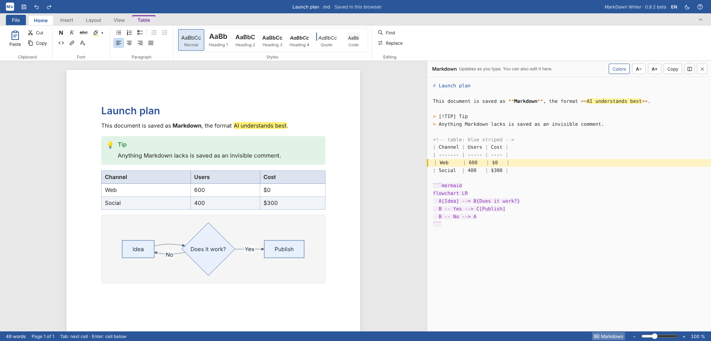
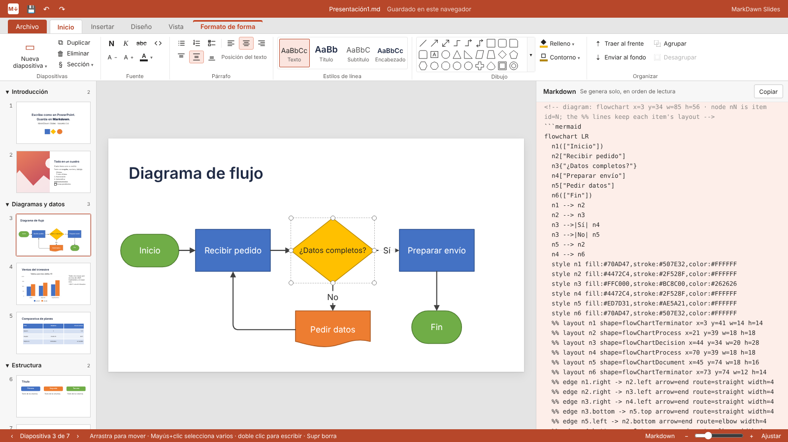
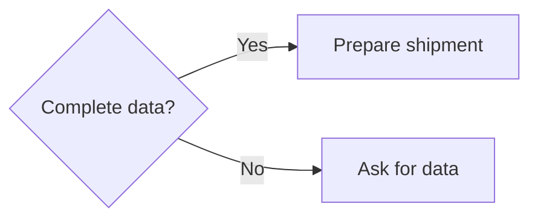
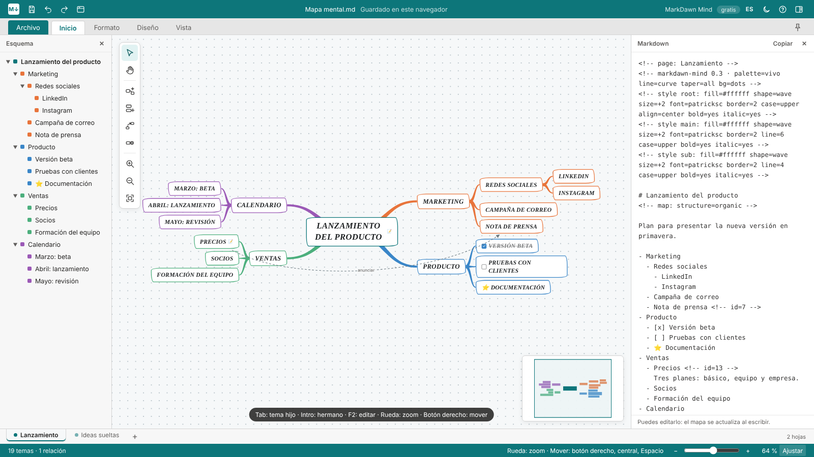

# MarkDawn Apps

**Familiar Office-style tools that save everything as Markdown.**

https://github.com/user-attachments/assets/b67082ba-e65e-4b73-922d-beafaa7a6ed3

*Shown: MarkDawn Writer Pro. The free version includes pages, editable tables, callouts, diagrams and dark mode; block dragging, columns and editable mind maps are part of [Writer Pro](https://diegocanodev.gumroad.com/l/markdawn-writer-pro).*

Markdown is the format AI models understand best, and it works everywhere: GitHub, Obsidian, wikis, documentation sites. But asking someone without technical knowledge to write in it is a real barrier. MarkDawn Apps keep the interface people already know and save only Markdown.

[Leer en español](README.es.md)

| App | What it is | Try it |
| --- | --- | --- |
| **MarkDawn Writer** | A Word-style document editor (English and Spanish) | [Live demo →](https://markdawn.net/writer/) |
| **MarkDawn Slides** | A PowerPoint-style slide editor | [Live demo →](https://markdawn.net/slides/) |
| **MarkDawn Mind** | Mind maps with an Office-style ribbon (English and Spanish) | [Live demo →](https://markdawn.net/mind/) |

Each one is a single HTML file with no dependencies and no build step. The [home page](https://markdawn.net/) links to all three. Writer and Mind can also be **installed as apps** from Chrome, Edge or Safari: they get their own window and icon and work offline.

---

## MarkDawn Writer

**Write like in Word. Save as Markdown.**



You never see a `#` or `**` while you write, and every document is saved as clean Markdown that people, tools and AI models can read.

- **Word-style ribbon** with File, Home, Insert, Layout and View tabs, plus a Table tab when you are inside a table
- **Styles gallery**: Normal, Heading 1–4, Quote and Code, plus bold, italic, strikethrough, **highlight**, inline code and links
- **Lists**: bulleted, numbered and task lists, with Tab and Shift+Tab to change levels
- **Page view like in Word**: paper size, orientation, margins and page thumbnails; the PDF matches the screen
- **Tables you edit right on the page**: a **+** to add rows and columns, menus to insert, move, align or delete, and colors for the header, banded rows, the first column or any column
- **Colored callouts** (`> [!TIP]`), **footnotes**, **code with colors**, **formulas** (KaTeX) and **diagrams** (Mermaid: flowchart, mind map, sequence, Gantt, pie, timeline)
- **Live Markdown panel** on the right, left or bottom, resizable, with colors or plain text, that you can also edit directly
- **Markdown shortcuts while typing**: `# `, `- `, `1. `, `> `, `[ ] `, `**bold**`, `==highlight==`, `` `code` ``
- **Opens any `.md` file** without breaking it, and pastes cleanly from Word, Google Docs and web pages
- Navigation pane, collapsible headings, find and replace, zoom, undo and redo, word count
- **Six themes** to view the document (Word, Plain, Academic, Notion, GitHub and Reading) and **dark mode**; the Markdown doesn't change
- **Export PDF** and **Copy for Word** (pastes with formatting into Word, Google Docs or Outlook)
- **Working folder** (Chrome and Edge): documents save themselves to your folder, plus export or import your settings
- **English and Spanish** interface, collapsible ribbon and built-in help (**F1**)

Download the folder with the HTML and its `libs/` folder (Mermaid and KaTeX) from [Releases](https://github.com/diegocano-dev/markdawn-apps/releases) to use it offline.

**[Writer Pro](https://diegocanodev.gumroad.com/l/markdawn-writer-pro)** adds Notion-style block dragging, columns, mind maps and flowcharts in three styles of its own, and mind maps you edit right on the page.

Markdown has no alignment, so Writer stores it as an invisible comment above the block:

```markdown
<!-- align: center -->
# Welcome
```

---

## MarkDawn Slides

**Design slides like in PowerPoint. Save them as Markdown an AI can read and rebuild.**



- **Free layout**: move and resize anything, with smart guides, an optional grid and 20+ slide layouts
- **90+ shapes** with their PowerPoint names, plus fill, outline and text colors
- **Rich text per line**: title, subtitle, heading, text, bulleted, numbered and task lists, bold, italic, code, vertical alignment
- **Connectors** that stick to shapes: straight or elbow, with rounded corners, arrows at either end, text on the arrow, and routing that avoids other objects
- **Flowcharts saved as Mermaid**, which GitHub, Obsidian and many viewers draw automatically
- **Charts** (column, bar, line, pie, doughnut) and **tables** (8 styles, row and column formatting) saved with their real data
- **Reading order** worked out automatically, with groups and reading zones for blocks that belong together
- **Sections**, slideshow mode, resizable panels and zoom
- **Export to simple Markdown**: no comments or positions, readable in any Markdown viewer

### How a slide is saved

Each item is a comment with its position and size in % of the slide, followed by normal Markdown, listed in reading order:

```markdown
---

<!-- slide 2 · layout: imageLeft -->

<!-- image: x=0 y=0 w=45 h=100 -->


<!-- text: x=50 y=10 w=45 h=20 valign=bottom -->
# Quarterly results

<!-- text: x=50 y=34 w=45 h=56 -->
- Sales +12 %
- Three new customers
```

Shapes joined by connectors are written as one Mermaid flowchart. The `%%` lines are Mermaid comments that keep each shape's exact position, so viewers ignore them and MarkDawn Slides restores the layout:

````markdown

````

---

## MarkDawn Mind

**Mind maps like in Office. Saved as Markdown any AI can read.**



This repository has **MarkDawn Mind**, the free edition. Its interface is in English and Spanish and follows your browser's language. You can switch it with the ES / EN button.

> **[Mind Pro](https://diegocanodev.gumroad.com/l/markdawn-mind)** adds every map style, 30+ shapes, org chart, timeline and radial layouts, high-resolution and SVG export, images inside topics and custom per-level styles.

- **Keyboard first**: Tab adds a child topic, Enter a sibling, just start typing to edit
- **Organic maps** with tapered, curved branches, plus right-side and tree (folder-like) layouts
- **Topics stay where you drop them**, branches included; drop one on another topic to move it there
- **Navigation your way**: zoom towards the pointer, pan with the right or middle button or Space, all configurable (View → Mouse and zoom)
- **Several sheets in one file**, notes, tasks, markers, links, relationships and floating topics
- **Live Markdown pane** you can also edit, outline, minimap, dark mode, ribbon at the top, left or right
- **Open or paste any outline**: Markdown, indented text (like what XMind copies), bulleted lists or OPML; each level becomes a branch
- **Reveal the map level by level** with a slider, and shorten long topics with "…"
- **Export as an image**: PNG or JPG (up to Full HD), or copy and paste it anywhere
- **Background textures**: paper, linen and notebook
- Built-in help: press **F1**

**Mind Pro** adds more map styles (3D relief, metal-framed plates…), org chart, timeline and radial layouts, more than 30 shapes, 10 branch types, 3D branches, 25 color sets and your own colors, your own per-level styles, hand-drawn shapes, images inside topics, 12 textures or your own background image, and high-resolution and SVG export. It opens the same files.

### How a mind map is saved

The map is a plain nested list. Formatting and positions go in HTML comments that viewers don't show:

```markdown
<!-- markdawn-mind 0.3 · palette=vivo line=curve taper=all -->
<!-- style main: shape=pill border=2 line=6 case=upper -->

# Product launch
<!-- map: structure=organic -->

- Marketing <!-- color=#e8743b -->
  - Social media
  - Press release
- Product
  - [x] Beta version
  - [ ] Customer testing
```

Files with several sheets start each one with `<!-- page: Name -->` and separate them with `---`.

---

## Use them

- **Online**: open the live demos linked above.
- **Offline**: download `writer/index.html` (Writer), `slides/index.html` (Slides) or `mind/index.html` (Mind) and open it in any modern browser.
- **In your own page**: Writer and Mind expose a small API.

```js
MarkDawn.getMarkdown();          // returns the document as Markdown
MarkDawn.setMarkdown('# Hello'); // loads Markdown into the editor

MarkDawnMind.getMarkdown();          // the whole mind map file
MarkDawnMind.setMarkdown('# Idea\n- One\n- Two');
```

## Roadmap

- Open `.md` files in Slides
- Themes: fonts and colors for a whole document or presentation, without changing the Markdown
- English interface for Slides
- Installable app (PWA) and Microsoft Store version
- A renderer library and plugins to view MarkDawn files in Obsidian, VS Code and websites

## Contributing

This project **does not accept code contributions** (pull requests). If you have an idea or find a bug, please tell us in [Issues](https://github.com/diegocano-dev/markdawn-apps/issues): every suggestion is read. You can also write to [hello@markdawn.net](mailto:hello@markdawn.net).

## License

© 2026 Diego Cano. From November 2026, new versions are released under the [GNU General Public License v3](LICENSE): you can use, study, share and modify them freely, but any version you distribute must also be GPL v3, with its source code. Versions published before then remain under the MIT license.

**MarkDawn** and its logo are the author's trademarks: modified versions must use a different name.
